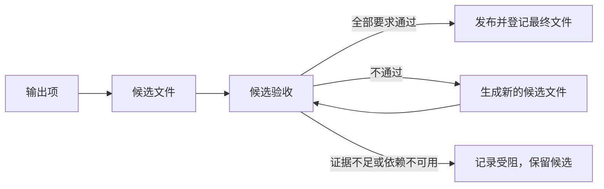

# Output Item + Candidate Validation + Published Output 数据模型设计稿

日期：2026-09-22。状态：待评审。本文定义输出项、候选验收与已交付文件的建议模型，不代表相关能力已经实现。

依据：Q01–Q24 阶段性收口报告及本轮源码检查。源码基线为 `feature/unique-output-name`，`HEAD` 为 `df9829bbc0eb2ca1d1017c213c48959f983e134e`，同时存在报告列出的未提交修改；本文以当前工作区为检查对象，不把这些修改描述为已合并。

当前实现以 [architecture.md](../../architecture.md) 为准，工程约束以 [engineering.md](../../engineering.md) 和 [defensive-patterns.md](../../defensive-patterns.md) 为准。本文只保存设计取舍；实施并验证后，再更新当前架构与界面文档。

**核心建议：一个输出项描述一项用户预期；工具可以为它生成多个候选文件；验收绑定具体候选；只有必要检查通过且发布成功，文件才进入已交付结果。**

## 1. 目标和范围

```text
Goal                  设计目标        让输出数量、来源、验收和最终路径都有可追溯事实。
Problem               当前问题        解决单一路径冲突、坏成片占位和中间文件冒充交付。
Impact Scope          影响范围        视频应用层、媒体工具结果、桌面产物投影及持久化读取。
Non-goals             范围之外        本稿不设计任务队列、并发、播放器、配音或通用工作流。
```

本模型首期用于视频成片，覆盖单视频编辑、多视频独立输出及已有的多视频拼接。普通问答不创建输出项；通用文本文件创建继续遵守现有审批和 `artifacts` 契约。字幕、文稿可以作为独立文本产物交付，但不能因此把视频标为已经配音或已经完成语义验收。

本文不预建文件类型注册表或通用验证器框架，也不把视频规则放入智能体核心。跨轮原位覆盖已经交付的文件、批次整体回滚、自动清理历史候选和崩溃后的自动续跑不在首期范围。

对应问题：P02、P12 是本模型直接解决的对象；P04/P05/P06 需要本模型承载验收证据，但关闭这些问题还依赖真实语义检查能力；P14 消费本模型提供的逐项结果。P15/P16 的执行与事件契约另行设计。

## 2. 已确认的实现缺口

- [桌面主进程](../../../apps/desktop/src/main/index.ts)在提交轮次时，从第一个视频推导输出路径并递增全局 `outputSequence`。文件尚未写出也会消耗序号。
- [任务提示构建](../../../apps/desktop/src/main/agent-task.ts)只支持一个预设输出路径；[系统指令](../../../packages/video-agent/src/system-prompt.ts)还存在多个输入倾向于合并、最后一个工具必须写出、写出后又必须检测的冲突。
- [视频工具](../../../packages/video-ffmpeg/src/index.ts)的 `videoCreated` 将每次成功写出的剪辑文件直接报告为 `artifacts`；宿主因此不能区分中间片段、待修成片和最终交付。
- [智能体循环](../../../packages/agent-loop/src/index.ts)在模型不再调用工具时结束轮次；这不代表用户要求已全部满足。
- [视觉工具](../../../packages/vision-openai/src/index.ts)返回采样帧描述；当前没有能证明全片满足任意语义条件的验收器。

原始证据：[Q01](../../../logs/continuous-acceptance/2026-09-22-q01-black-frame-issue.md)、[Q06](../../../logs/continuous-acceptance/2026-09-22-q06-batch5-result.md)、[Q24](../../../logs/continuous-acceptance/2026-09-22-q24-vision-guided-cut-result.md)。这些验收日志受 Git 忽略规则管理，不是随仓库分发的规格。

## 3. 概念、关系与身份

```text
Output Item           输出项          用户要求得到的一项视频结果，包含来源、目标和要求。
Candidate             候选文件        已由工具成功生成，并被选中用于某一输出项验收的文件。
Candidate Validation  候选验收        针对一个候选文件，逐条记录要求的检查结果与证据。
Published Output      已交付文件      必要检查通过且成功发布到最终路径的文件。
Tool Result           工具结果        工具实际执行的事实，由循环写入会话历史。
Session               会话历史        模型可见业务事实的只追加来源。
Turn                  任务轮次        一次用户输入及其连续模型和工具操作。
Projection            读取投影        从已有事实计算展示结果，不再保存一套权威业务状态。
```



一个轮次可以声明多个输出项；一个输出项可以关联多个来源文件。因此五个输入分别输出是五项，五个输入合并是一个关联五个来源的输出项。来源路径不充当输出项标识；同一个来源可以参与不同输出项。

一个输出项可以有多个候选，一个候选可以有多次验收；首期一个输出项最多对应一个已交付文件。验收失败后生成新文件必须创建新的候选身份，旧验收不能转移给新候选。

会话归属来自宿主的会话容器，轮次及工具调用归属来自现有 `tool.result` 事件。不在每个业务对象里复制 `sessionId`、`turnId`、`traceId`。跨进程展示需要的关联标识由宿主在投影时补充；本稿不引入另一套任务标识或调度实体。

以下 TypeScript 类型是建议契约，不是已导出的接口。示例使用普通字符串标识，实际接入时复用已有 `ToolCallId` 等类型。业务标识由应用层生成，模型只能引用工具返回的标识。

## 4. 输出项

```ts
type OutputTarget =
  // 用户明确指定的最终路径，冲突时不能擅自改名。
  | { readonly kind: 'explicit'; readonly path: string }
  // 应用层给出的默认首选路径，发布时再按磁盘占用选择可用名称。
  | { readonly kind: 'automatic'; readonly preferredPath: string };

type OutputRequirement = {
  // 在所属输出项内唯一，供验收逐条关联；不是验证器注册名称。
  readonly id: string;
} & (
  // 应用层为所有视频成片自动加入，模型不能删除。
  | { readonly kind: 'decodable-video' }
  // 只在当前任务明确要求时长时加入，单位为秒。
  | {
      readonly kind: 'duration-range';
      readonly minSeconds: number;
      readonly maxSeconds: number;
    }
  // 针对当前黑段检测能力，不把它解释为片名或制作名单检查。
  | { readonly kind: 'no-black-segments' }
  // 保存用户要求本身，不假设当前已经具备对应自动验收能力。
  | { readonly kind: 'semantic'; readonly description: string }
);

interface OutputItem {
  readonly id: string;
  // 本项对应的视频来源；音轨、字幕等辅助输入仍从实际工具调用追溯。
  readonly sourcePaths: readonly string[];
  readonly target: OutputTarget;
  // 应用层创建的本项工作目录，供中间文件和候选使用。
  readonly workingDirectory: string;
  readonly requirements: readonly OutputRequirement[];
}
```

`sourcePaths` 和目标路径在声明边界解析为真实使用的绝对路径；相对路径沿用当前已确认的目录语义。默认名称由每个输出项分别推导，多个输入合并时仅借选定来源生成默认文件名，不因此改变输入语义。

`sourcePaths` 记录预期来源，不能单独证明成片内容正确。应用层还应沿实际媒体工具调用核对本项原始视频输入的归属，内部片段通过其生产结果追溯；片段顺序、切点和内容是否符合要求仍需成片验收。不为此持久化另一份工具依赖图。

`workingDirectory` 是应用层在目标父目录内创建的本项专用目录，其名称不使用最终交付序号。它用于定位候选、限制视频工具写出位置以及保留失败证据，不等于通用本地文件工具的工作目录授权。模型不负责创建或授权这份媒体工作目录。

首期一个轮次只接受一次完整输出项声明，声明列表就是预期交付集合，不另加批次对象、总数字段或计划版本。声明成功后，数量、来源、目标和要求保持不变；错误声明在接受前返回错误，目标或要求确需改变时明确开始下一轮，不通过删除失败项把部分完成改成全部完成。

模型根据用户需求提交声明，应用层检查当前使用的路径、非空来源、目标冲突及字段合法性。结构化检查不能证明模型正确理解了全部自然语言；它可能漏报“必须五项”或漏报某条语义要求。因此需要在任务事实中保留原始用户请求，并在真实验收中核对声明是否完整。只有确有影响执行的歧义时才请求澄清，不新增每次都要批准输出计划的流程。

所有声明条件都是必要条件，不设模型可自行切换的 `required: false`。时长范围必须忠实表达用户要求，模型不能为了让坏成片通过而放宽范围；精确时长的帧级容差由媒体时间基和既定验收规则确定。语义要求没有可用检查方法时仍保留，后续验收明确受阻。

## 5. 候选文件

```ts
interface Candidate {
  readonly id: string;
  readonly outputItemId: string;
  // 已成功生成的文件，位于所属输出项的工作目录中。
  readonly path: string;
  // 指向当前轮次中真正生成该文件的成功工具结果。
  readonly producerToolCallId: string;
}
```

不是每个中间文件都登记为候选。裁剪片段、抽帧和标准音频继续作为工具过程事实；模型选择某个已生成视频进入验收时，应用层才从对应成功工具结果建立候选记录。验收同一个生产调用生成的同一路径时复用候选身份。

候选成立必须有成功的生产工具结果，不能只凭磁盘上有文件或模型给出一条路径。应用层解析该工具结果的结构化 `outputPath`，不能从“Video created”之类文字里提取路径。跨输出项目录中的文件不能直接冒充本项候选。

候选文件在本应用内采用写出后不覆盖的规则；修复一律写新路径并形成新候选。最终交付通过复制候选完成，保留候选原路径，使历史工具事实继续可定位。本稿不引入内容寻址、文件监控或全文件摘要机制；候选身份绑定的是受控生产调用与不覆写路径，不宣称能够检测任意外部程序改写。

只把目录位置写进提示词不足以保证上述规则。实施时，实际视频写出调用边界必须限制输出落在所属工作目录内，拒绝直接写到最终目标或已有候选路径。此约束由视频应用层组装时落实，媒体工具继续负责实际写入及禁止覆盖；不放入通用智能体循环。

## 6. 候选验收

```ts
type RequirementCheck = {
  readonly requirementId: string;
  // 引用真实工具结果，不接受模型自由填写的“证据已通过”。
  readonly evidenceToolCallIds: readonly string[];
  // 用于解释发现和缺口；发布判断依赖结构化结论及其真实证据。
  readonly detail: string;
} & (
  | { readonly outcome: 'passed' | 'failed' }
  | {
      readonly outcome: 'blocked';
      readonly reason: 'capability-unavailable' | 'tool-error' | 'insufficient-evidence';
    }
);

interface CandidateValidation {
  readonly id: string;
  readonly candidateId: string;
  // 覆盖所属输出项的每条必要要求，每项恰好一次。
  readonly checks: readonly RequirementCheck[];
}
```

```text
Passed                检查通过        针对该要求的有效证据支持通过，不能扩大到未检查范围。
Failed                检查不通过      有效证据证明要求未满足，例如检测出明确黑段。
Blocked               检查受阻        工具不可用、调用失败或证据不足，尚不能判断通过。
```

验收工具读取声明、生产结果和证据结果，自己计算 `checks`。模型可提交候选和证据引用，不能提交 `outcome`、修改声明条件或提供一个布尔值代替验收。

证据必须属于当前候选：直接媒体检查的实际输入路径必须对应候选路径；视觉观察还须沿抽帧工具结果追溯到该候选及采样时刻。源视频上的检查、另一个候选的通过结果、模型回复文本以及诊断日志都不能替代最终候选的验收证据。

一次验收覆盖全部要求。缺少某项证据时，为该项生成 `blocked`，不能省略后对剩余数组求“全部通过”。畸形工具数据属于边界错误，不转换成空数组或通过结果。证据引用为空仅适用于确实尚无证据的受阻项。

检查不通过或受阻可以作为验收工具成功执行后的业务结果，即 `ToolResult.status: 'success'` 内包含非通过的 `checks`。工具参数错误、非法引用或验收自身无法执行才使用外层工具错误。检查执行成功与候选合格是两件事。

### 6.1 当前要求的检查依据

`decodable-video` 要求文件存在、包含可用视频流并完成全文件解码。现有 `probe_media` 只能提供媒体信息，不足以证明完整可解码；实施需要在 `video-ffmpeg` 中补齐真实解码检查，并以工具结果保存检查事实，不能把旧的探测结果直接当作该项通过。

`duration-range` 使用候选的真实探测时长，按声明范围比较，不从源视频时长或模型计算值推断。实际使用的媒体检查结果应保留参与比较的时长。

`no-black-segments` 使用 `detect_black_segments` 检查该候选全片。当前参数为 `blackdetect=d=0.04:pix_th=0.10`，它判断的是该参数下的黑段；不能承诺更短黑帧也全部被检出，更不能推断没有黑底白字片名。实施时将实际使用的检测参数与区间写入该检查工具的结果，以便历史结论可解释。模型不能通过提高阈值、缩短检查范围或漏传检测结果使本项通过。若用户要求超出该检测能力，保留为未满足的检查范围，不擅自降级。

`semantic` 首期用于忠实保存内容要求和未验证原因。现有采样帧描述可以提供某处出现片名等反例线索，但形成程序可使用的否定结论仍需明确的判定方法；“采样中没有发现”更不能证明全片不存在。当前尚无获评审认可的判定和覆盖方法时，这类要求统一记为 `blocked`，不能仅凭一次视觉接口成功生成 `passed`，也不能接收模型自由填写的 `failed` 冒充验收器。后续具体检查具备可靠反例判定后，可以使用现有 `failed` 分支，无需新增状态。

语义覆盖方案的检查区间、采样方式及通过标准需要另行评审。这里不预建策略注册接口，也不加入没有操作入口的人工验收字段。

### 6.2 重验与汇总

同一轮次内，同一候选可以在外部服务恢复或取得补充证据后重新验收。每次生成新记录，旧记录不修改；该候选的当前结论由会话事件顺序中最近一次验收决定。输出项的当前候选则是最近一次送验的候选；发布不能挑选旧记录绕过当前不通过结果。若确实要重新选用之前的候选，应把它重新送验，使选择与验收事实明确进入历史。

检查数组全部通过才允许发布。任何已确认不通过项都会阻断发布；没有不通过项但存在受阻项时仍阻断发布。展示时保留所有原因，不因存在一个不通过项就隐去其他证据缺口。

## 7. 已交付文件与发布边界

```ts
interface PublishedOutput {
  readonly outputItemId: string;
  // 经应用层复核的最近一次全项通过验收，可据此追溯候选。
  readonly validationId: string;
  // 实际发布成功的绝对路径；这是最终路径的权威事实。
  readonly path: string;
}
```

不增加独立的发布标识、文件名副本、成功布尔值或序号字段。发布记录在其所属输出项内唯一，发布工具的调用标识来自外层事件，界面文件名由真实路径推导。

发布输入只接受验收引用。应用层从引用反查候选、所属输出项和目标，复核引用属于本项当前候选的最新验收、全部要求通过、该项尚未交付，并确认候选仍可读取。模型不能在发布时重新指定更宽松的条件或另一条文件路径。

发布成功的工具结果同时返回 `PublishedOutput` 和 `artifacts: [published.path]`。两处路径必须来自同一个发布结果值；`artifacts` 保留现有通用交付入口，业务对象提供来源和验收关联，不维护第二套可独立修改的路径表。

### 7.1 默认名称和明确路径

- 默认目标在发布时从本项 `preferredPath` 开始按实际文件占用选择名称，如 `clip-edited.mp4`、`clip-edited-2.mp4`。不再从全局持久化计数器取起点。
- 候选失败、尚未写文件时取消、声明后未执行，都不会占用最终名称。
- 用户明确路径已存在时返回冲突，不覆盖、不擅自换名，也不以目录扫描到的旧文件认领成功。
- 同一声明中两个明确目标落到同一路径时，在声明边界拒绝；默认目标的实际竞争由发布时的独占创建解决。

检查存在性只用于选择名称，真正创建目标必须使用不覆盖的文件系统操作。默认目标的独占创建报告已存在时可以继续下一个名称；权限、磁盘和其他错误直接返回，不能伪装成名称占用而反复重试。

### 7.2 写入、取消与失败

首期建议以独占创建目标后复制候选的直接实现发布。复制完整结束且文件关闭成功才返回发布成功；不重新编码，避免验收后改变媒体内容。该方案保留候选，也会增加磁盘占用，首期不另加自动清理机制。

取消发生在写入完成前，停止复制并清理本次调用独占创建的未完成目标；不能删除原有文件或其他输出项的结果。清理失败必须报告真实错误，残留文件不能登记为已交付，后续也不能自动覆盖它。

最终文件已经完整写入并关闭后，返回成功事实，再由循环处理轮次取消；不能因为随后收到取消就把真实交付改写成“没有产物”。当前循环已有成功工具结果入会话后检查取消的行为，需要保留。

另一个实施核对点是当前循环先等待完成诊断回调，再追加 `tool.result`。为防止诊断写入失败遮蔽已发布事实，建议将成功或失败工具结果的会话追加放在完成诊断之前，再传播诊断异常。该调整只改变通用事实记录顺序，不向核心引入视频模型或发布分支。

文件写入、内存会话追加和宿主磁盘保存不构成一个原子事务。本阶段不承诺任意进程崩溃下的恰好一次交付；异常退出可能留下未登记文件。重启后文件存在只影响名称占用，不自动补写通过记录。正常终态保存失败必须暴露，不能报告历史已经可靠保存。

## 8. 工具结果和会话存储

建议将以下业务事实放入现有 `ToolResult.output`。类型归属 `packages/video-agent`；不向核心 `SessionEvent` 联合类型增加视频事件。

```ts
type VideoOutputFact =
  | {
      readonly kind: 'video.outputs.declared';
      readonly items: readonly OutputItem[];
    }
  | {
      readonly kind: 'video.candidate.validated';
      readonly candidate: Candidate;
      readonly validation: CandidateValidation;
    }
  | {
      readonly kind: 'video.output.published';
      readonly output: PublishedOutput;
    };
```

建议用三个具体应用工具承载当前消费者：`declare_video_outputs` 声明完整输出集合，`validate_video_candidate` 从生产结果建立候选并汇总真实证据，`publish_video_output` 执行发布。名称为设计建议，实施时与工具注册、指令和测试一起确定；不增加通用操作分发器。

模型只提交声明内容、生产结果引用和检查结果引用。上述事实中的标识、工作目录、实际路径和检查结论均由应用层产生。应用工具通过组装时获得的只读会话事实查找关联；工具仍返回结果，由智能体循环统一追加事件，不直接修改会话或驱动下一轮模型。

普通视频编辑工具改为返回结构化生产结果，例如 `{ outputPath }`，不再直接报告 `artifacts`。本应用中的视频交付只有发布工具报告 `artifacts`；抽帧及语音中间文件保持过程用途。通用文本创建仍在真正创建成功后报告 `artifacts`，不被强制套入视频验收。

事实读取只接受相应已注册应用工具返回的结构，不把任意工具输出中碰巧相同的 `kind` 当成发布事实。该匹配在视频应用层有一个权威实现，桌面与命令行共用。

## 9. 逐项结果与批量汇总

```ts
type OutputItemResult =
  | {
      readonly outputItemId: string;
      readonly status: 'published';
      readonly output: PublishedOutput;
    }
  | {
      readonly outputItemId: string;
      readonly status: 'failed' | 'blocked' | 'incomplete';
      readonly reason: string;
    };
```

这是轮次收尾时的读取投影，不是又一套需要工具推进的持久状态机。首期按如下规则计算：

1. 已有成功发布事实的输出项为 `published`，后续其他项失败或整轮取消不回滚它。
2. 未发布项以其最近一次明确选择进入验收的候选为当前候选；最近验收存在不通过项为 `failed`，只有受阻项为 `blocked`。
3. 已通过验收但发布失败，按真实发布错误标为 `failed`，不能因为验收通过就进入已交付列表。
4. 声明后未处理、只有中间文件、还没完成候选验收或没有发布调用的项为 `incomplete`。工具执行失败等已知原因写入解释，不把没有质量证据的项伪装成验收不通过。
5. 整轮取消和异常是独立的执行结果，仍与上述交付事实一起返回。例如“任务已停止，3 项已交付，2 项未完成”。

总数来自声明列表，分类数量来自逐项结果，不另存可漂移的成功计数器。五项中四项发布、一项失败时显示部分交付；不能删掉失败项后变成四项全部完成。

没有声明却尝试调用视频写出工具时，实际写出边界拒绝执行，收尾说明“视频交付流程未完成”，不能把空列表解释为全部成功。只读媒体分析、问答和没有视频写出尝试的普通文本任务，视频交付结论为不适用；它们仍按原任务结果返回。仅靠本模型不能检测模型完全未执行、也未声明的自然语言视频请求，这属于意图识别与真实验收范围，不能声称数据结构已经解决。

结果区读取已交付集合并展示逐项缺口；候选和检查证据从执行过程定位。模型的最终文字可以解释结果，但不能修改程序计算的数量和状态。取消、失败结果同样携带实际已发布项，沿用已有错误结果传递产物的能力。

## 10. 持久化、恢复与旧历史

新事实随现有会话事件保存，不建立第二份业务数据库或可独立编辑的输出清单。客户端保存的是展示投影；重新加载时，视频交付结果从会话事实重建，草稿、折叠状态等界面事实继续由客户端快照负责。

读取交付事实时应扫描原始成功工具结果，不能只扫描已完成步骤。当前取消可能发生在成功工具结果写入后、步骤结束前；这些文件仍是真实产出。模型上下文继续使用现有完整步骤规则，不把残缺工具调用链重新送给模型。

跨轮继续处理失败任务时，首期声明新的输出项。历史已交付文件或候选可以作为本轮编辑来源；新一轮工具写出新的工作文件后，再建立本轮候选并验收。首期不支持直接承接旧轮次候选发布，也不能跨轮拿旧验收批准新交付。这意味着跨轮恢复可能需要重新生成候选；直接承接的收益和关联规则另行评审，不增加恢复令牌、后台续跑或自动重放。

旧会话中的视频 `artifacts` 继续可见、可定位，展示为历史产物。因为没有输出声明和验收证据，不能补造 `CandidateValidation`、不能显示“已验收”，也不能猜测旧批次总数。此规则是读取既有数据的必要处理，不保留两套新生产写入契约。

移除全局 `outputSequence` 的行为后，新命名只依赖真实磁盘占用；旧快照里的计数值不再参与命名。具体读取调整只兼容实际已有快照字段，不建立通用版本迁移框架。

## 11. 典型场景

### 11.1 五个输入分别输出

声明五个输出项，各自关联一个来源和明确目标。某一项的模型示意如下，标识在真实执行中由应用层生成：

```ts
const batchItem: OutputItem = {
  id: 'out-01',
  sourcePaths: ['D:/media/batch-01.mp4'],
  target: { kind: 'explicit', path: 'D:/media/batch-01-result.mp4' },
  workingDirectory: 'D:/media/.agent-output-out-01',
  requirements: [
    { id: 'r-media', kind: 'decodable-video' },
    // 此例使用 25 帧每秒素材，一帧容差；不是所有任务的通用默认值。
    { id: 'r-duration', kind: 'duration-range', minSeconds: 4.96, maxSeconds: 5.04 },
  ],
};
```

循环完成并不自动形成五个成功项；每项都要存在自己的发布结果。不能额外插入从首个输入推导的第六个最终目标，也不能把五项改成一项拼接结果。

### 11.2 多个输入合成一个视频

声明一个输出项，`sourcePaths` 包含全部使用的视频来源。多个裁剪片段是中间文件，拼接后的文件成为候选；验收和发布各围绕这一项展开。实际片段顺序仍由真实剪辑工具调用说明，声明不复制完整剪辑工程。

### 11.3 坏候选修复后交付

```ts
const candidateA: Candidate = {
  id: 'candidate-a',
  outputItemId: 'out-01',
  path: 'D:/media/.agent-output-out-01/attempt-a.mp4',
  producerToolCallId: 'call-render-a',
};

const validationA: CandidateValidation = {
  id: 'validation-a',
  candidateId: candidateA.id,
  checks: [
    {
      requirementId: 'r-media',
      outcome: 'passed',
      evidenceToolCallIds: ['call-check-a'],
      detail: '存在视频流，全文件解码完成。',
    },
    {
      requirementId: 'r-duration',
      outcome: 'failed',
      evidenceToolCallIds: ['call-probe-a'],
      detail: '实际时长为 4.5 秒，不在声明范围内。',
    },
  ],
};

const candidateB: Candidate = {
  id: 'candidate-b',
  outputItemId: 'out-01',
  path: 'D:/media/.agent-output-out-01/attempt-b.mp4',
  producerToolCallId: 'call-render-b',
};

const validationB: CandidateValidation = {
  id: 'validation-b',
  candidateId: candidateB.id,
  checks: [
    {
      requirementId: 'r-media',
      outcome: 'passed',
      evidenceToolCallIds: ['call-check-b'],
      detail: '存在视频流，全文件解码完成。',
    },
    {
      requirementId: 'r-duration',
      outcome: 'passed',
      evidenceToolCallIds: ['call-probe-b'],
      detail: '实际时长为 5 秒，处于声明范围内。',
    },
  ],
};

const published: PublishedOutput = {
  outputItemId: 'out-01',
  validationId: validationB.id,
  path: 'D:/media/batch-01-result.mp4',
};
```

上述调用标识仅展示关联关系，真实运行必须能在会话中找到对应结果。候选 A 保留在过程记录，候选 B 发布后成为唯一交付结果；最终目录不需要出现失败的首版、`v2` 和 `v3` 成片。

### 11.4 视觉服务失败

输出项保留“无片名卡、无制作名单”等必要语义要求。技术解码和黑段检查即使通过，语义项仍因视觉调用失败或覆盖不足记为 `blocked`，没有发布记录；已有候选继续可定位。同一轮次内服务恢复后可以对同一候选追加验收，但服务恢复不等于已经具备足够的覆盖方法；重新剪辑则建立新候选。

### 11.5 取消与部分交付

五项中三项已经发布，第四项生成了候选，第五项尚未开始。取消后保留三条发布事实，第四、第五项仍显示未完成及具体原因；不把第四项候选提升为结果，也不删除前三项文件。

### 11.6 已有结果的下一轮修改

下一轮引用已交付文件作为来源，声明新输出项并写出新的候选。默认最终名在发布时避让旧文件。用户要求原位替换时，首期明确说明当前发布不覆盖已有文件；不以发布工具绕过文件修改审批，不重写旧发布记录。

## 12. 模块职责与最小改动面

```text
Video Application     视频应用层      定义本稿模型，落实声明、候选、证据关联、发布和结果投影。
Media Tools           媒体工具层      执行探测、编辑、解码和黑段检测，返回实际使用的数据。
Vision Tool           视觉工具层      返回真实采样观察及外部错误，不决定剪辑或整体交付成功。
Desktop Host          桌面宿主        保存会话，发送结果和错误，负责本机审批及文件定位。
CLI Entry             命令行入口      消费同一组应用工具和交付投影，避免保留另一条成功口径。
Shared Client         共享客户端      展示已交付项、缺口和过程引用，不自行进行质量判断。
Agent Core            智能体核心      继续驱动模型和工具并追加通用事实，不认识视频业务模型。
```

建议类型、应用工具与单一投影实现放在 `packages/video-agent`。文件复制和媒体业务的应用编排在这里直接实现，具体 FFmpeg 检查仍位于 `video-ffmpeg`。这会扩展当前仅组装依赖的应用层职责，实施时必须同步修改架构文档；不另建包或通用管理器。

`model` 的 `ToolResult`、`session` 的事件联合类型无需增加本稿业务字段。若应用层源码开始直接引用它们的类型，按实际引用补齐包清单，而不是依赖传递依赖。`agent-loop` 仅在前述工具事实与诊断记录顺序确需调整时修改通用顺序。

`apps/desktop` 删除视频专属单一路径和提前消耗序号的策略，复用应用层交付投影，并继续从通用 `artifacts` 识别文本产物。`packages/client` 接收必要的逐项结果，不独立复制验收算法。批量结果的具体布局仍以未来更新的 `docs/desktop-ui.md` 为唯一视觉依据。

## 13. 实施验收条件

1. 同轮修复：首个候选不通过、第二个通过时只发布第二个，旧候选证据不被转用。
2. 声明完整性：五项、十项、二十项独立输出按各自目标交付，漏项保留为未完成；拼接任务仍只交付一项。
3. 命名：尚未发布时取消不跳号；不同输入独立命名；目标真实存在时不覆盖。
4. 检查含义：外层验收工具成功而某项检查失败时，发布仍被拒绝；缺少任何必要检查也不能发布。
5. 证据归属：源视频、别的候选、别的输出项或别的轮次的检查不能批准当前候选。
6. 语义边界：视觉服务失败或只有不足以覆盖要求的采样时，显示受阻；黑段检查通过不能升级为片名和制作名单检查通过。
7. 发布失败：复制失败或中途取消不登记产物，只清理本次未完成目标；清理失败明确暴露。
8. 取消事实：发布已经完成后取消，已交付项仍保留；未完成步骤中的真实成功发布也能恢复展示。
9. 历史恢复：旧产物继续可定位，但不补造验收记录；新交付由会话事实重建。
10. 入口一致：桌面和命令行使用同一发布与汇总规则；问答及通用文本任务无需视频声明。

实施验证复用现有 `pnpm check`、相关模块测试、桌面构建及真实入口；不新建验证框架。真实成片复测要独立检查输出文件，不能仅断言本模型里的状态字段。视觉链路不可用时记为未验证，不能据此关闭语义剪辑问题。

## 14. 评审结论与实施前决策

建议接受的模型边界：输出项先定义预期集合；候选保持独立身份；验收逐项关联真实证据；发布才产生视频 `artifacts`；批量结果由声明和成功发布事实计算；会话历史保持只追加。

进入实现前需要确认三项具体取舍：

- 首期语义要求按本稿保留为必要条件，无合格覆盖方法时阻断交付；若要自动通过“全片无片名卡”等条件，需要先补一份可真实验收的覆盖方案。
- 首期采用保留候选并复制发布的方案，接受额外磁盘占用；不同时引入自动清理或原位覆盖。
- 首期输出声明成功后固定，变更目标和要求通过新轮次进行；跨轮处理须重新生成候选并验收，暂不支持直接承接旧候选发布。

本稿没有确定多任务档位，也不以本模型获认可作为启动并发、队列或播放器开发的依据。当前交付是设计文档，不包含生产实现、真实成片验收或 Git 提交。
