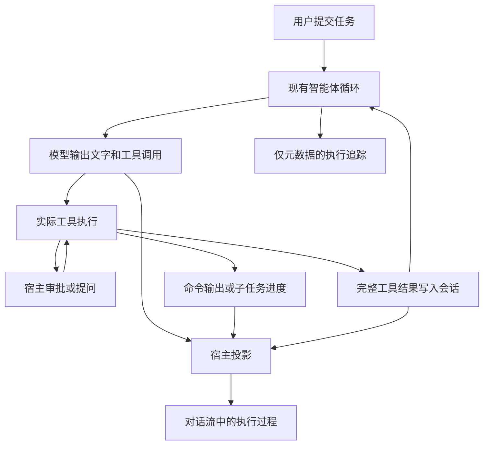
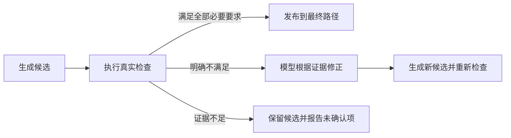

# Agent Desktop 六项运行时能力建设方案

日期：2026-09-23。状态：设计稿，已完成方案复核修订，尚未实施。本次交付仅为方案，不启动生产代码修改、依赖安装、外部模型调用或 Git 提交。

检查基线：`D:\Develop\Projects\agent-desktop`，分支 `feature/unique-output-name`，`HEAD` 为 `df9829bbc0eb2ca1d1017c213c48959f983e134e`。检查包含当前工作树内已有的对话流和工具详情修改，不把未提交内容描述为已合并。

## 1. 目标与六项范围

在现有智能体循环上，补齐执行命令、及时澄清、核验结果、有限恢复、解释进度和复杂任务协作的能力。视频剪辑继续使用现有专用工具；通用问答、文件与代码任务共用同一客户端和会话模型。

```text
English term              中文术语            本方案中的职责
Shell Execution           命令执行            经批准运行本地命令，展示输出并支持停止。
User Question             执行中提问          在信息不足时等待用户答复，继续当前任务轮次。
Result Review             结果检查            根据真实工具证据判断要求是否满足。
Bounded Retry             有限重试            对明确的临时失败最多追加一次自动尝试。
Commentary                过程说明            保留模型公开输出的中间说明，并关联对应步骤。
Subagent                  子智能体            执行有边界的独立子任务，向父任务返回结果。
Persistent Terminal       持久终端            在应用运行期间保留交互进程与输出。
```

前五行对应第 1–5 项；子智能体和持久终端共同属于第 6 项，拆成 6A、6B 两个独立阶段，不互为必要依赖。

```text
Goal                      目标                让已确认的六项能力形成可操作、可追溯的生产闭环。
Problem                   问题                当前只有有限工具，缺少上述执行、交互和结果契约。
Impact Scope              影响范围            模型与工具契约、循环、应用组装、宿主、会话和共享界面。
Non-goals                 范围之外            不建设插件市场、多运行时、通用工作流或后台任务平台。
```

用户请求已经足以支持编写六项设计，不能再以“参考界面没有对应能力”为由略过设计。实际实施时逐项引入有生产消费者的代码，不一次性预建后面所有接口。

## 2. 当前源码事实与需要修正的认识

### 2.1 已有基础

- [模型契约](../../../packages/model/src/index.ts)允许一次完整响应同时包含 `text` 和 `toolCalls`，支持 `onTextDelta`；工具结果只有成功与错误两种分支。
- [DeepSeek 适配器](../../../packages/model-deepseek/src/index.ts)使用流式响应，读取 `delta.content`，当前请求为 `thinking: { type: 'disabled' }`，没有自动重试。
- [智能体循环](../../../packages/agent-loop/src/index.ts)按顺序执行工具；同一轮可连续调用多次模型；以零工具调用结束。当前新增的 `onToolResult` 在 `tool.result` 追加到内存会话后执行。
- [工具契约](../../../packages/tools/src/index.ts)为 `execute(input, signal)`；没有调用上下文或执行中的输出回调。
- [应用组装](../../../packages/video-agent/src/index.ts)注册了目录、文本、搜索、媒体、语音和视觉工具；没有通用命令、提问、委派和终端工具。
- [审批端口](../../../packages/local-tools/src/workspace.ts)和[宿主审批实现](../../../apps/desktop/src/main/tool-approval.ts)支持目录、创建文件、修改文件三种操作。已有“等待用户决定后继续同一次工具调用”的机制。
- [宿主](../../../apps/desktop/src/main/index.ts)只允许一个前台任务，逐轮创建 Agent，跨轮保留 Session。关闭窗口时先取消任务并等待结束，再保存界面快照。
- [共享客户端契约](../../../packages/client/src/api.ts)已有工具活动、结果详情和文本增量；处理中不保存界面快照，终态由[持久化解析](../../../apps/desktop/src/main/session-persistence.ts)读取和保存。

“追加到 Session”目前指内存事实，不等于已经写入磁盘。正常关闭与进程崩溃的恢复保证不能混为一谈。

### 2.2 两个设计修正

**过程说明可以先做。** 当前模型协议已经能返回“先检查文件”这样的公开文字和工具调用。缺的是按步骤保留、分类和展示，不必等待供应商增加名为 `commentary` 的专有字段。它与模型内部推理正文是不同内容；本方案第 5 项不要求开启推理输出。

**等待答复可以沿用当前轮次。** 提问工具等待宿主返回答案，再把答案作为工具结果交回模型即可。首期不需要把 JavaScript 执行栈写到磁盘，也不需要新增跨重启恢复引擎。

结果检查沿用现有[输出项、候选验收与发布设计](./2026-09-22-output-item-candidate-validation-published-output-design.md)。该文档中的 `declare_video_outputs`、`validate_video_candidate`、`publish_video_output` 仍是建议接口，尚未注册，不能当成现有能力调用。

## 3. 共同架构与数据边界

```text
Agent Core                智能体核心          驱动模型与工具，维护通用会话事实和取消。
Application Layer         应用组装层          组装命令、提问、检查和子任务的实际消费者。
Desktop Host              桌面宿主            持有审批、问答等待和本机进程资源。
Shared Client             共享客户端          展示真实事件、收集决定，不执行本地操作。
Session                   会话事实            保存完整模型消息和工具结果，用于重建上下文。
Execution Trace           执行追踪            记录标识、状态、次数和耗时，不保存内容正文。
IPC                       进程间通信          沿现有 desktop:agent-event 通道传递展示事件。
```



### 3.1 最小契约调整

以下字段均为建议，只有对应阶段实施时才进入代码。

1. 第 1 项给工具增加 `ToolExecutionContext`（工具执行上下文），提供当前 `AbortSignal`、`toolCallId` 和同步的 `reportProgress`。首期只定义一种有真实消费者的进度：`command.output`，包含 `stdout`/`stderr` 来源、序号、文本片段和被丢弃片段计数；不把任意 `unknown` 负载或视频语义塞进通用契约。具体工具仍只返回最终结果，不控制循环。
2. `runTurn` 将现有位置参数整理为一个选项对象，保留 `trace`、`signal`、`onTextDelta`、`onToolResult`，在第 1 项加入 `onToolProgress`。同步更新所有实际调用方，不保留两套调用接口，也不引入事件总线。
3. 进度正文不写入诊断日志或模型 Session。宿主按 `sessionId + turnId + stepId + toolCallId` 投影实时事件；流结束后只保存最终工具结果和有界摘要。队列达到 64 KiB 时保留首尾摘要、增加 `droppedBytes`，不阻塞子进程，也不让 Renderer 的消费速度决定命令生命周期。
4. 跨进程事件由宿主附上 `sessionId`、`turnId`；工具内容再用 `toolCallId` 关联，模型文字用 `stepId` 关联。界面只更新匹配的会话和轮次，终态后丢弃迟到的轮次增量。进度投影失败必须作为宿主错误暴露，不能把命令成功改写成静默成功。
5. 第 6B 项的终端可跨轮存在，因此终端后续输出按 `sessionId + terminalId` 路由，不伪装成已完成轮次仍在运行；终端快照只保存历史，不保存可重新接管的进程句柄。

新增上下文类型放在已有工具契约所属包；模块直接引用新增类型时补齐真实依赖声明。核心层不引入 Electron、具体进程实现或视频检查规则。

`ToolExecutionContext` 只在第 1 项实施时进入 `packages/tools`；命令工具负责产生 `command.output`，宿主负责批处理、限额和 IPC 投影。没有其他真实工具消费者时，不扩展为通用进度协议。

首期执行接口固定为以下方向，避免把 `AbortSignal` 和进度回调继续作为位置参数增长：

```ts
interface ToolExecutionContext {
  readonly signal?: AbortSignal;
  readonly toolCallId: ToolCallId;
  readonly reportProgress: (event: ToolProgressEvent) => void;
}

type ToolProgressEvent = {
  readonly kind: 'command.output';
  readonly stream: 'stdout' | 'stderr';
  readonly sequence: number;
  readonly text: string;
  readonly droppedBytes?: number;
};

interface Tool {
  execute(input: unknown, context: ToolExecutionContext): Promise<ToolResult>;
}
```

`reportProgress` 是同步入队操作；工具不等待 Renderer，也不把 IPC Promise 带入 `packages/tools`。命令最终 `ToolResult` 另外返回 `truncated`、`droppedBytes` 和退出终态，实时事件丢失不会被解释为命令成功。

### 3.2 会话与恢复的首期保证

- 正常完成、失败、取消和正常关闭：保留已完成工具的真实结果、已确认的过程说明和有界输出摘要。
- 审批和待回答问题：只在当前宿主进程内有效。关闭时结束等待，不在重启后恢复为可批准请求。
- 崩溃后：恢复最后一次成功保存的历史；不承诺恢复未保存增量，不重放命令或工具副作用，也不宣称恢复同一轮执行。
- 旧快照：保留旧活动与产物；新增可选展示字段缺失时不补造内容。新增事件与结果分支要同步快照解析及上下文重建测试。

当前 `recoverSessionEvents` 会排除未完成步骤的模型消息、工具结果和 `tool.interaction.closed`。取消后这些事实仍可作为历史展示，但不会自动进入下一轮模型上下文；本方案不通过复制界面消息绕过该规则。`tool.interaction.closed` 是第 2 项唯一新增的 Session 事件，持久化解析器必须接受它，但不得把它投影成模型 `tool` 消息。

## 4. 第一项：命令、实时输出、逐命令审批和取消

### 4.1 用户得到什么

Agent 可以在用户确认的目录运行构建、测试、检查脚本和本机诊断。用户先看到确切命令，执行时看到输出，失败时能展开退出码和错误，停止时结束该命令的进程树。

已有视频、读取、搜索、精确编辑工具继续优先使用。通用命令解决这些工具无法表达的任务，不把已有操作全部改写成命令。

### 4.2 工具和审批

在 `packages/local-tools` 新增 `run_command`，首期正式支持 Windows 的非交互 PowerShell 命令。由宿主解析并固定解释器绝对路径；命令以独立参数或编码参数交给进程 API，不拼进第二层 `cmd /c`。不静默在不同命令解释器间切换。

```ts
// 拟议模型输入；最终名称在本阶段实现时确定。
type RunCommandInput = {
  command: string;
  workingDirectory?: string;
  timeoutMs?: number;
};

type CommandOutcome = {
  command: string;
  workingDirectory: string;
  exitCode: number | null;
  termination: 'exited' | 'timed-out';
  stdout: string;
  stderr: string;
  truncated: boolean;
};
```

默认使用会话已确认目录，显式子目录需要解析为真实目录并符合当前目录范围；没有目录时先调用现有目录确认工具。

扩展现有审批类型，宿主给审批卡提供解释器、完整命令、实际目录和超时值。每次命令调用重新审批，不使用“本会话始终允许”，不根据命令前缀推断只读。拒绝后不启动任何进程；用户要修改命令时拒绝旧请求，由模型重新提交。

必须在产品说明与卡片中准确表达：**这是一项以当前用户权限执行的本机命令授权。工作目录只是执行起点，无法限制任意脚本访问其他目录、网络或调用其他程序。** 首期不是操作系统沙箱；不以路径校验或命令黑名单宣称隔离。如果发布要求变成“禁止越界执行”，需要单独交付真实隔离方案，不能靠修改文案完成。

子进程环境由宿主构造，只传运行工具链所需的基础变量和明确的项目配置；不直接复制包含模型密钥的全部 `process.env`，也不把设置中的密钥注入命令。此举减少意外暴露，但不能将同用户权限进程描述为无法读取本机凭据的安全边界。

### 4.3 输出与终态

- 用 `spawn` 读取 `stdout` 与 `stderr`，分别增量解码，保留来源标记和宿主收到的顺序；不能宣称两条流之间有操作系统保证的精确顺序。
- 首期建议两条流合计保留 64 KiB 的首尾摘要，明确显示截断。用约 50 ms 的小批次更新界面，发送队列和界面缓存也必须有上限，不只限制最终结果。
- 默认命令超时 120 秒，模型可请求的首期上限 600 秒；这是建议常量，不新增设置页面。超时结束命令并返回失败，不无限等待交互式输入。
- 退出码为 0 只代表该命令正常退出。非零退出、启动失败和超时保留失败语义；不能因为收到输出而标为完成。
- 错误分支需要保留退出码与有界输出：给 `ToolResult` 的错误分支增加当前命令消费者需要的可选结构化 `output`，同步模型格式化、主进程投影、持久化与测试。不能只保存一条错误文字而丢弃命令输出。
- 不从输出里猜测交付文件，不因命令返回路径就追加 `artifacts`。视频正式交付仍走第 3 项的验收与发布事实。

### 4.4 停止和关闭

同一轮的 `AbortSignal` 传入审批等待、进程执行和输出订阅。点击停止后，使未答复审批失效；已启动命令需要结束由它创建的受支持进程树，等待退出并收尾输出，再让该轮进入终态。

Windows 首期可用固定参数调用系统 `taskkill.exe /PID <ownedPid> /T /F`，但必须通过真实的 PowerShell → `.cmd` → Node 孙进程用例验证。只调用 `child.kill()` 不能证明后代已退出。提前脱离父进程或守护化的命令不在一期生命周期保证内，不把它们当成成功保留的后台服务；这类任务交给第 6B 项。

取消仍按 `AbortError` 结束，不返回普通工具失败让模型继续执行。宿主把已经收到的有界输出放进该轮取消后的展示快照；未完成步骤不假装成为模型可见的成功结果。正常关闭复用当前“取消 → 等待收尾 → 保存”的顺序。

### 4.5 改动与验收

改动位置：`local-tools` 的命令工具和审批目标，`tools` 的执行上下文，`agent-loop` 的通用进度转发，`video-agent` 的有条件注册，Desktop 的进程审批和事件投影，Client 的命令详情与浅色审批卡。

最少验收：

1. 批准前进程未启动；批准后只执行卡片所示内容一次；拒绝与过期批准均不执行。
2. 真实命令交错输出中文、长行和错误流，界面持续更新且内存不会随无限输出增长。
3. 真实非零退出和超时如实失败，输出可查。
4. 停止与关闭结束子进程和孙进程；检查其实际存活状态，不能只断言收到取消事件。
5. 正常关闭重开后能查看结果，旧审批不可操作；崩溃重开不会自动执行旧命令。
6. 视频剪辑、无附件问答与原有文件审批回归通过。

## 5. 第二项：执行中提问并继续当前轮次

### 5.1 用户得到什么

例如“导出竖屏还是横屏”“保留原声还是静音”尚不明确时，Agent 在输入框上方提出一个具体问题。用户回答后继续当前任务，不必取消、重新描述上下文或重新执行已完成步骤。

### 5.2 最小机制

在当前应用组装层增加 `ask_user` 工具，注入宿主的提问回调。它不是文件工具，不放进 `local-tools`；首期直接在现有 `video-agent` 应用层组装，不为一个工具新建包。

```ts
type AskUserInput = {
  question: string;
  options?: readonly string[];
};

type UserAnswer =
  | { outcome: 'answered'; answer: string }
  | { outcome: 'skipped' };
```

首期一次只问一个问题，可提供 2–4 个选项，始终支持自由文本；不加复杂表单或文件上传。待决问题同时带 `requestId` 和所属轮次标识，宿主验证答复属于当前问题。

```text
模型调用 ask_user
  → 工具等待宿主答复
  → 输入框上方显示问题卡，停止按钮仍可用
  → 用户提交答案或明确跳过
  → 工具返回结构化答案
  → 循环追加 tool.result
  → 当前步骤完成，模型在同一 turnId 内继续
```

当前工具串行执行，因此问题和命令审批不会同时挂起。答案通过新的 `answerQuestion` 宿主接口返回，不触发 `runAgentTask`；待回答时允许填写问题卡，原任务输入区保持原有处理态和草稿。

问题卡使用独立答案输入，不复用当前任务的主输入框：主输入框继续保持处理中禁用并保留草稿，问题卡在其上方提供选项、自由文本和“跳过”。共享客户端新增 `answerQuestion(requestId, outcome)`，Desktop Preload 只转发该请求，Main 通过当前待决问题校验 `requestId`、会话和轮次后再唤醒工具。问题事件加入 `AgentRuntimeEvent`，因此 Web 测试宿主和 Electron 宿主使用同一展示契约。

“跳过”是明确的未回答结果，模型不能把它当成选中默认选项。停止任务或关闭窗口则用 `AbortError` 结束等待。迟到答案、重复答案和已关闭问题的答案由宿主拒绝。

### 5.3 历史、权限与恢复

完整问题在 `tool.called.input`，答案在 `tool.result`；界面可在对应工具行展开问答记录。没有答案就不写假答案。

回答问题不等于批准后续文件修改或命令执行，后续操作仍走其既有审批。首期不允许模型把提问工具用于绕过审批。

关闭时中断等待，并追加一个不进入模型上下文的 `tool.interaction.closed` Session 事件，记录 `toolCallId`、`requestId` 和 `reason: 'cancelled' | 'window-closed'`。该事件只供历史投影显示“未回答/已停止”，不能伪造 `tool.result`，也不能让未完成 Step 进入下一次模型请求。重启只恢复历史，不能承诺继续同一个仍在等待的调用。跨重启续跑需要新的持久化检查点设计，本阶段不以“继续原轮次”的名称暗示已经支持它；旧快照缺少该事件时按“历史中没有关闭原因”读取。

### 5.4 改动与验收

改动位置：`video-agent` 的工具和可选宿主端口，Desktop 的待回答状态与 IPC，Client 的问题卡和问答详情；循环和 Session 基本语义复用现有实现。

验收：答案实际出现在下一次模型请求中；答复前后 `turnId` 一致；已完成工具不重跑；选项、自定义答案、跳过、停止、关闭、重复提交各有真实结果；历史恢复没有可操作的旧问题卡；普通发送和审批卡不串用。

## 6. 第三项：基于真实结果的检查

### 6.1 用户得到什么

Agent 能回答“检查了什么、通过了什么、哪里不满足、哪里尚无证据”。视频生成成功后，还能明确区分可用候选和真正交付的成片。

不把模型说“我检查过了”、工具退出码为 0、或 `turn.completed` 单独当作用户目标已经完成。

### 6.2 检查范围

首期重点是视频：文件存在、可解码、实际时长、要求有无音轨、黑段，以及明确的内容要求。现有 `probe_media`、`detect_black_segments`、语音和视觉结果可以提供部分证据；全文件解码检查仍需补齐实际实现。

首期只把视频候选作为正式 Review 消费者。代码和文本任务仍可展示实际命令、文件读取或差异，但不在本阶段生成通用的“检查通过”状态；未经解析核对不能声称“通过 N 个测试”。如果后续出现稳定的代码或文本验收消费者，再单独定义其证据类型和发布边界，不在本方案中预建通用检查器。

### 6.3 唯一判定来源

采用既有[候选验收与发布设计](./2026-09-22-output-item-candidate-validation-published-output-design.md)中的输出项、候选、逐项检查和发布关系，不另建一套 `ReviewManager` 或由界面维护的成功状态。

```text
Passed                    已通过              本项有匹配当前候选的证据，且满足要求。
Failed                    未通过              有证据证明本项不符合要求。
Blocked                   无法确认            缺少必要能力、服务或覆盖证据，不能当作通过。
```

`validate_video_candidate` 的输入引用当前候选和已执行检查；应用层核对证据来源、工具调用标识、候选身份和要求，宿主只投影它实际返回的逐项结果。模型不能自行提交 `passed: true` 来盖过失败证据。

对同路径被改写的文件，历史验收不能继续适用。沿用不可覆盖的独立候选文件，发布前确认候选内容与验收对象一致；原地修改或新生成的内容必须重新验收。

黑段检测通过不能证明“全片没有片名卡”；稀疏抽帧也不能证明全片语义条件。视觉服务不可用或覆盖不足时，该项为 `blocked`。

### 6.4 检查与发布、修复的关系



完整交付阶段同时落地既有设计的声明、候选、验收和发布，替换当前“任意成功剪辑工具产物都展示为成片”的投影。只加检查卡可以作为中间实现，但不能据此宣布交付语义已修复。

修正是一次新的工具调用和新候选，不是重新执行旧命令的网络重试。建议每项首期最多自动修正两次，之后明确列出差距，由用户决定是否调整目标或继续，避免长任务无限生成文件。已发布的其他输出保留。

### 6.5 改动与验收

改动位置：视频应用层的声明、验收和发布逻辑，媒体层的缺失检查，Desktop 的结果投影，Client 的检查详情和候选/交付展示。视频规则不进入 `agent-loop`。

验收：不合格候选不发布；旧候选证据不批准新候选；服务失败为无法确认；取消不回滚已经交付的文件；多输出逐项报告，漏项不算全部完成；复制或发布失败不登记产物；真实成片独立复测，与卡片状态核对一致。

## 7. 第四项：有明确失败分类的有限重试

### 7.1 用户得到什么

模型服务出现短暂限流或服务异常时，客户端可以自行再试一次，保留当前任务。遇到权限、参数、确定性工具错误时直接展示原因，不通过反复尝试掩盖问题。

### 7.2 首期策略

首期只对 DeepSeek 模型请求实现自动重试，策略由 `model-deepseek` 的实际网络边界负责。其他模块不再嵌套一层相同重试，特别是不重新执行整个 `runTurn`。Provider 不把 DeepSeek 的 HTTP 错误类型泄漏到 `agent-loop`；它把外部失败映射为 `@agent-desktop/model` 所属的供应商无关 `ModelRequestError`，携带 `kind`、可选 `statusCode` 和可选 `retryAfterMs`。`agent-loop` 只依赖这个通用错误契约。

- 可重试：HTTP 429、502、503、504，或已识别的临时连接错误；只在尚未向消费者报告文本或工具调用增量的阶段。
- 不重试：401/403、参数错误、用户取消、响应结构异常、缺少终止标记、达到长度上限，以及已经开始输出之后的断流。首期也不以“所有 5xx”作为一律重试条件。
- 每个模型 Step 最多两次 HTTP 请求，即首次加一次重试；一个 Turn 最多消耗两次额外请求。达到 Turn 预算后，后续 Step 不再自动重试并直接暴露原始错误。一次重试只能针对当前尚未产生完整响应的模型请求，不能重放已完成的 Tool。
- 默认等待 1 秒。服务端提供有效 `Retry-After` 时按其等待；超过首期 10 秒等待预算则结束并报告稍后再试，不提前无视服务端建议重发。
- 等待和新请求共用原取消信号。用户停止后不再发起下一次请求。

`ModelRequestError` 只保留当前循环需要的分类，不把 DeepSeek 响应对象带入 Core：

```ts
type ModelRequestErrorKind =
  | 'transient-service'
  | 'authentication'
  | 'invalid-request'
  | 'protocol'
  | 'cancelled';

interface ModelRequestError extends Error {
  readonly name: 'ModelRequestError';
  readonly kind: ModelRequestErrorKind;
  readonly statusCode?: number;
  readonly retryAfterMs?: number;
}
```

只有 `transient-service` 且尚未开始有效响应时允许进入重试；`cancelled` 永不重试。`statusCode` 和 `retryAfterMs` 仅是外部边界已解析的事实，不允许界面根据状态码自行决定重试。

重试预算由 `runTurn` 的当前运行上下文持有；Provider 只负责把真实外部错误映射为 `ModelRequestError`，不持有跨 Step 预算。循环在收到可重试错误后产生 `model.retrying` 事件，等待 `retryAfterMs`，再用同一个 `AbortSignal` 发起一次新的模型请求。新增契约只有当前 DeepSeek 消费者需要的次数控制和事件报告职责，不演变为通用重试框架。命令和文件写入不消费这个模型请求预算，也不被自动重放。

一次未获响应的模型请求仍可能已经在服务端计费；额外尝试会增加延迟和成本，方案不承诺服务端恰好执行一次。

### 7.3 展示和诊断

为模型请求增加供应商无关的 `model.retrying` 通知，包含当前步骤、尝试序号、原因分类、等待时间；由循环补齐身份并产生相应诊断元数据。界面显示“服务暂时不可用，准备第 2 次尝试”，最终状态与原模型步骤关联，不把它计为额外工具调用。`model.retrying` 不创建新的 Step，也不追加 `assistant.message`。

失败响应正文和凭据不进入执行追踪；最终异常继续保留原始可解释原因。只有完整模型响应才能追加一次 `assistant.message`，失败的请求不能产生可执行工具调用。

### 7.4 后续边界与验收

命令非零退出、文件部分写入、视频生成和发布均不自动原样重试。模型提出修正方案后产生新调用，按该操作重新审批与验收。视觉请求是否需要有限重试可在该服务有真实失败证据后复用策略原则，首期不扩大到所有工具。

验收：首次 503 后成功只产生一份最终消息和一组工具调用；持续 429 按次数与等待预算结束；401 不重试；等待中取消没有第二次请求；已输出后的断流不重复显示文本；第二次模型尝试不重新执行之前已完成工具；所有尝试和耗时可核对。

## 8. 第五项：真实过程说明

### 8.1 用户得到什么

对话中能按时间顺序看到模型实际说的“我先检查目录”“这段包含片名，需要调整切点”等中间说明，随后是对应工具和最终回答。每条文字都有真实模型消息来源。

### 8.2 数据来源与分类

沿用 `delta.content` 和完整 `ModelResponse.text`，无需新增供应商专有字段：

- 模型步骤正在流式输出时，显示该步骤的临时文字，不提前判断它是不是最终答复。
- 完整响应含工具调用时，其非空 `text` 是调用前的过程说明；循环保存完整消息后发布带 `stepId` 的确认事件。
- 完整响应不含工具调用时，其文本是本轮最终回答。
- 步骤没有文字时不造一条说明，也不额外调用模型仅为美化界面生成播报。

可以在应用层系统指令中要求复杂操作前给出简短、面向用户的说明，但不要求每个读取工具都输出一段话，不请求内部推理链。

### 8.3 事件和界面

当前 `text.delta` 没有步骤身份，多个模型步骤的文字可能累加到一段临时文本后被最终回复覆盖。实施时给增量附上 `stepId`，每一步单独开始、累加和确认；完整响应确定用途后，将同一条临时文字转为过程说明或最终回答，避免显示两遍。

在已有活动列表中增加真实说明条目，放在其工具调用之前；复用已有列表与共享样式，不建立第二份工具顺序表。`analysis` 继续仅表示模型调用状态，不能改名为推理正文。

完整说明已经存在于 Session 的 `assistant.message.content`，界面快照只保存展示所需的投影。取消或失败后保留此前已完整确认的说明；未完成模型响应的片段不伪装成确认消息。旧快照不自动回填“模型可能说过”的内容。

原有“模型正文的增量不进入诊断日志”保持成立。需要保存的完整说明只进入会话和对应展示快照。

### 8.4 验收与推理正文边界

验收：两次带文字的工具调用后接最终答复，显示顺序与真实步骤一致；最终文字不被复制到过程区；无文字时没有空节点；中途失败保留已确认说明；重开历史仍可查看；只有最终答复的普通问答不多出说明行。

模型内部推理正文不属于本组六项中的必要交付。若之后单独要求，应先验证所选模型实际支持的推理字段及工具往返协议，再设计单独的输出通道；不能把过程说明或“分析任务”当作内部推理。

## 9. 第六项：子智能体与持久终端

### 9.1 6A：受限的子智能体

#### 生产用途

把明确独立的只读任务交给子智能体，例如一个查找字幕中的片段，一个整理剪辑说明；父智能体综合结果后继续决策。首期不让多个智能体同时改文件或写同一视频。

#### 执行边界

在现有应用层新增 `delegate_tasks` 工具，由应用层提供的 `DelegateTasksPort` 调用同一 `runTurn`。这是应用层依赖核心循环，核心循环不反向依赖子智能体实现；`delegate_tasks` 自身不导入 Provider、不读取 API Key，也不在工具内部递归组装父 Agent。

```ts
type DelegateTasksInput = {
  tasks: readonly {
    title: string;
    instruction: string;
  }[];
};
```

首期一轮最多创建两个子任务，允许二者并行，深度固定为一层；超限直接返回可解释结果，不加入排队系统。父工具等待这些子任务收尾，因此仍保持“一个前台父任务”的产品形态。

`DelegateTasksPort` 由 Desktop 应用层注入 `createVideoAgent`，并只暴露一次明确的子任务运行入口：

```ts
interface DelegateTasksPort {
  runReadOnlyTask(input: {
    readonly instruction: string;
    readonly workingDirectory?: string;
    readonly signal: AbortSignal;
    readonly onEvent?: (event: Readonly<SubagentEvent>) => void;
  }): Promise<SubagentResult>;
}

type SubagentEvent =
  | { readonly type: 'started'; readonly taskId: string }
  | { readonly type: 'tool'; readonly taskId: string; readonly toolName: string; readonly status: 'running' | 'completed' | 'failed' }
  | { readonly type: 'completed'; readonly taskId: string };

type SubagentResult = {
  readonly taskId: string;
  readonly status: 'completed' | 'failed' | 'cancelled' | 'budget-exhausted';
  readonly summary?: string;
  readonly evidence?: readonly string[];
};
```

Desktop 的实现负责创建子 Agent、DeepSeek Model、独立 `InMemorySession` 和只读 Tool Registry；父 Agent 只接收该端口返回的结构化摘要。子 Agent 创建时不注册 `delegate_tasks`，因此深度限制由工具注册边界保证，而不是依赖模型遵守提示词。

每个子任务有独立 `InMemorySession`、任务标识和取消控制器；输入只包含明确委派说明、必要材料和受限目录，不复制父会话全部历史。工具注册使用明确的 `list_directory`、`read_file`、`search_text` 只读集合；不注册目录变更、写文件、命令、终端、提问或再次委派。现有媒体工具没有同样目录约束时，不直接加入这个只读集合。父任务的 `AbortSignal` 取消时，端口实现必须先取消全部子任务，再等待其 `runTurn` Promise 收尾后返回父工具结果。

建议首期每个子任务最多 8 次模型步骤、120 秒执行时间；预算耗尽显示未完成，不伪装成完成。`runTurn` 只有在此真实消费者出现时增加步骤上限选项，普通父任务不因此被任意截断。

#### 结果、取消与历史

父工具用逐项结果返回每个子任务的成功、失败、取消或预算结束原因。容器工具调用成功只表示汇总返回，不表示所有子任务成功。父模型需依据具体结果判断信息是否足够。

父任务取消会广播到所有子任务，并等待它们结束；一个子任务普通失败不取消其他独立子任务。父模型不在子任务尚未收尾时宣称整个委派完成。

宿主将子任务的实时事件嵌套在父工具行，使用父轮次和子任务身份隔离，不能混进父会话的模型步骤。每个子任务结束后保存完整有限会话记录与结果，关联父调用；父模型只接收必要摘要和证据引用，不再注入整份子会话。

首期是当前轮次内的协作，不提供后台跨轮运行、崩溃续跑、自动 Git 合并或独立侧栏会话。

#### 验收

两个真实子任务独立调用模型与只读工具并汇总；子任务无写入权限入口；一个失败保留另一个结果；父取消后无遗留请求；超过深度、次数和时间预算有明确结果；历史能追溯父子关系；总成本增加有实际请求数量依据。

### 9.2 6B：应用运行期间的持久终端

#### 生产用途与“持久”的含义

适用于开发服务器、长时间构建和需要后续输入的命令。同一应用进程和会话内可复用终端；跨应用重启只恢复输出历史，不复活进程，不自动重跑旧命令。

#### 技术落点

第 1 项使用普通管道进程。第 6B 项才引入伪终端，用于真实交互、尺寸和控制字符，不用普通 `spawn` 模拟终端行为。

```text
PTY                       伪终端              为交互式命令提供终端输入、输出和尺寸。
ConPTY                    Windows 伪终端      Windows 提供的伪终端机制。
node-pty                  进程终端绑定        Node 侧候选依赖，创建和控制真实伪终端。
xterm.js                  终端显示组件        浏览器侧候选依赖，正确渲染终端控制序列。
```

先做独立 Windows/Electron 验证，确认原生模块与 Electron ABI 匹配、构建资源可打包、中文显示和进程关闭正确，再按工程规则固定版本。宿主依赖留在 Desktop；终端显示依赖只放有实际消费者的客户端。此方案不预先安装依赖。

终端资源的运行态由 Desktop Main 按 `sessionId` 持有，不能存在每轮都会重建的 Agent 内。首期每会话最多一个终端，直接扩展现有 `DesktopSessionState` 的会话映射，不新增通用资源管理器。`terminalId` 由 Main 生成并在每次 `read_terminal`、`write_terminal`、`close_terminal` 调用中校验会话归属；模型不能提交任意进程 PID 或系统终端标识。

#### 操作与权限

- `open_terminal`：指定工作目录和初始命令，逐次审批后启动，返回宿主生成的 `terminalId`。
- `read_terminal`：读取当前终端的新增有界输出和存活状态，可短暂等待；不以无限轮询占住模型。
- `write_terminal`：模型向交互进程发送确切输入，每次先展示输入内容并审批。批准启动 shell 不等于批准它以后接收的所有命令。
- `close_terminal`：关闭当前会话拥有的终端；停止与尺寸调整由宿主已有控制入口承担，不新增审批。

宿主验证标识属于当前会话，不能让模型拿任意系统进程标识发送输入。界面操作通过专用 IPC，不把任意终端 API 直接暴露给渲染层。

#### 输出与生命周期

伪终端通常只有合并后的终端输出，不声称仍能可靠区分 `stdout` 和 `stderr`。显示独立的“终端运行中”资源状态，不能把持续有输出等同于某条命令成功。

首期根据实际进程退出报告终态；交互 shell 内部某条命令是否结束，没有可靠协议时不凭提示符或一段文本判断。需要逐命令退出码的任务继续使用第 1 项。

终端输出跨轮到达时更新会话终端视图，不继续改写旧轮次的完成状态。正常轮次完成可以保留终端；用户点击停止任务时，停止本轮创建或操作的终端，但不关闭本轮未使用的既有终端。删除会话、关闭应用时结束所属终端并等待进程树收尾。

快照新增可选的 `terminalHistory`，保存 `terminalId`、工作目录、初始命令、有界输出尾部、最近观察到的状态和退出码；不保存 PID、句柄或可重新接管的进程对象。恢复解析器对旧快照按没有终端历史处理，对新快照把所有运行态统一恢复为 `disconnected`。重启后原终端显示“连接已结束”，不显示仍在运行，也不自动重跑旧命令。删除会话和正常关闭先关闭该会话全部终端并等待进程树收尾，再保存快照；强制结束宿主是否可能遗留进程是原生终端验证项目，未证明进程树回收前不能承诺崩溃即清理。

#### 验收

真实启动本地开发服务器并持续读取；同会话下一轮访问同终端；其他会话不能写入；模型输入每次审批；中文、尺寸调整和控制字符正确；用户停止、关闭终端、删除会话、关闭应用都实际结束所属进程；重启没有假运行状态和隐式重启。

## 10. 实施顺序与阶段交付

六项保持原编号，建议开发顺序调整为 **1 → 2 → 5 → 3 → 4 → 6A / 6B**。第 5 项已有真实文本来源，风险和依赖小，前置后也更方便观察第 3、4 项。第 6A 与 6B 根据任务需求先后实施，二者不要求一起上线。

### 10.1 进入实施前的方案门槛

在创建第一项功能分支前，以下契约必须保持本稿与实现计划一致：

```text
Retry boundary             重试边界          ModelRequestError 由 Provider 映射，runTurn 统一计数和取消；每 Step 一次重试、每 Turn 最多两次额外请求。
Question history           提问历史          answered/skipped 使用 tool.result；关闭使用 tool.interaction.closed；未完成 Step 不进入模型上下文。
Progress contract          进度契约          首期只有 command.output；宿主 64 KiB 首尾摘要并记录 droppedBytes，不阻塞子进程。
Subagent runner            子智能体入口      Desktop 注入 DelegateTasksPort；子 Agent 只读且不注册 delegate_tasks。
Terminal ownership         终端所有权        Main 按 sessionId + terminalId 持有运行态；快照只保存已结束历史，重启不复活进程。
Review scope               检查范围          首期正式验收消费者只有视频候选；代码和文本不产生通用通过状态。
```

任一门槛未满足时，只继续补充设计和测试契约，不先创建占位接口、按钮或依赖。

```text
Phase                     阶段                独立交付与依赖
P1 Command                命令闭环            命令审批、输出、取消和历史；补通用执行进度。
P2 Question               提问闭环            同轮等待和答复；复用现有串行工具与宿主交互。
P3 Commentary             过程说明            按模型步骤保留公开文字，无需启用推理输出。
P4 Review                 检查与交付          落实候选验收和发布，完成真实视频结果复测。
P5 Retry                  有限重试            模型请求一次追加尝试，取消和轮次预算有效。
P6A Subagent              子任务协作          两个只读子任务；依赖身份隔离与进度展示。
P6B Terminal              持久终端            依赖命令权限和进程回收，单独通过原生依赖验证。
```

工程实施使用符合仓库规范的功能分支。当前工作树已有大量修改，进入实施时先核对基线并保留已有工作；不能通过重置或批量还原来整理。每阶段单独验收、审查和交付，后续阶段不提前创建空接口或占位按钮。

这份设计不把“执行整个方案”默认为只执行一小段；后续实际推进范围以用户当时明确授权为准，已授权范围内的常规实现与修复不重复询问。

## 11. 验证与完成口径

每个阶段复用现有验证入口：

```powershell
corepack pnpm check
corepack pnpm desktop:build
corepack pnpm client:web:test
corepack pnpm desktop:dev
```

若变更涉及依赖安装，按工程基线使用锁文件安装并验证。界面实现采用 `desktop-frontend` 技能，实际尺寸、布局与验收矩阵统一维护于 [desktop-ui.md](../../desktop-ui.md)；本稿不复制另一份视觉基线。基线架构与工程约束分别见 [architecture.md](../../architecture.md)、[engineering.md](../../engineering.md) 和 [defensive-patterns.md](../../defensive-patterns.md)。

单元与集成测试优先保留真实循环、会话、注册表和工具，只替换模型网络等外部边界。命令和终端必须补真实 Windows 进程测试；模型请求、子智能体和视频检查必须补对应的真实服务或媒体链路。

本次复核新增的契约测试最低包括：`ModelRequestError` 的 503/429、401、取消和部分流响应分类；每 Step 与每 Turn 的 Retry 预算；`tool.interaction.closed` 在历史投影中可见但不进入恢复上下文；命令进度达到上限后的首尾摘要和 `droppedBytes`；子 Agent 未注册 `delegate_tasks` 且父取消后无遗留模型请求；终端快照恢复为 `disconnected` 且不会根据 PID 重启进程。

```text
Implemented               已实现              正式代码存在且接通当前实际调用方。
Automated Verification    自动化验证          类型、行为、架构与界面检查在目标改动上通过。
Real Verification         真实链路验证        实际模型、文件或进程走完，并有可核对结果。
Integrated                已集成              经授权提交或合并到明确基线，与工作区实现区分。
```

浏览器模拟宿主只能证明共享界面行为；构建通过不能证明命令已回收、模型重试正确或成片语义合格。缺少真实验证条件时记录未验证范围，不能用已有工具详情的测试结果替代新能力验收。

本稿的阶段退出标准是该项用户行为、失败路径、取消、历史展示和真实验证均成立。只有卡片没有运行时来源，或只有后端没有可用交互，均不算该项完成。

## 12. 对现有项目的影响与建议取舍

- **能力范围**：命令和提问扩展通用任务闭环；检查改善视频交付；过程说明提高可见性；重试解决有限临时失败；子任务与终端服务复杂工作。
- **性能与存储**：命令、终端输出必须有界，展开视图按需渲染；子任务历史因数量与步骤上限而受限。已有会话文件会增加内容，不承诺无成本增长。
- **模型成本**：过程说明复用实际响应，不增加专用播报调用；重试和子任务明确增加请求，检查也会增加工具或模型调用。
- **权限范围**：通用命令和终端获得当前用户级进程能力，授权粒度高于原来的具体文件修改。若需要强目录隔离，要作为单独的操作系统边界能力实现。
- **依赖范围**：前五项与只读子任务优先沿用现有依赖；只有持久终端预计需要原生进程绑定和终端显示组件。
- **视频行为**：第 1、2、4、5、6 项不替换已有剪辑工具；第 3 项有意调整“什么算交付成功”，需要与既有候选设计同时验收。

建议采用本文中的首期边界：逐命令审批、提问只保证进程内继续、视频验收关联候选、模型请求最多追加一次、过程说明取真实公开文字、子任务只读且两项以内、终端仅保证应用运行期间持久。原生终端选型以真实兼容性验证决定，不为方案完整性预先引入依赖。
